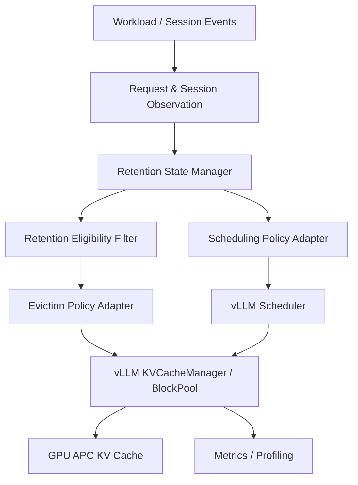

# KV Cache Management Optimization for LLM Inference

## Goal

This course project studies **cost-aware KV-cache eviction for LLM serving** on a real vLLM backend.

The broader system context includes retention/protection and scheduling coordination, but the research contribution remains centered on one primary decision:

> **When GPU KV-cache capacity is insufficient, which cached blocks/prefixes should be evicted to minimize future recomputation cost?**

The project therefore uses the following hierarchy:

```text
Primary research core
    Cost-Aware Eviction / Victim Selection

Supporting cache mechanism
    Retention / Protection

System coordination
    Scheduling
```

Retention and scheduling are included where needed to reproduce strong system baselines and to evaluate later coordination extensions. They do not replace eviction as the main research problem.

## Current Status (as of 2026-11-10)

**Repository:** [zhengjiahong-ai/LLM-KV-Cache-Optimization](https://github.com/zhengjiahong-ai/LLM-KV-Cache-Optimization)  
**Current main HEAD:** `f005ecf239c1a982d0a751f430e24fa8ca47e46e`

- Phase 0 / 1A / 1B: **CLOSED**. The common vLLM/APC adapter and the project’s Continuum-style baseline have been integrated and real-runtime validated.
- Phase 2A–2I: historical research and bounded evaluations are closed; their positive, negative, and inconclusive findings remain scoped to their original evidence.
- Phase 3 Protocol v4 — Option F: **FROZEN**. Protocol v3 remains historical.
- G0 v3: **ACCEPTED by M1 on 2026-11-07**. The sealed cohort contains 40 qualified tasks, 20 Workload Groups, and 10 repositories. The existing 40-run A0 Load Calibration is reused.
- One-shot execution: **270-run pipeline authorized on 2026-11-09**, comprising 30 A0 Noise Calibration runs followed automatically by 240 Main Campaign runs if the machine-verified transition gate passes.
- Execution state: **AUTHORIZED, NOT STARTED** as of this repository snapshot. The authorization is not evidence of a reserved GPU allocation or a completed run. M6’s pre-launch host/runner/allocation confirmation must be recorded before launch.

The 270 new runs are exactly:

| Stage | Runs | Scope |
| --- | ---: | --- |
| A0 Noise Calibration | 30 | 5 frozen Groups × C1/C2 × 3 repeats |
| Main Campaign | 240 | 20 Groups × C1/C2 × 6 arms |
| **Total new runs** | **270** | One continuous compute window |

The earlier 40-run A0 Load Calibration is existing evidence bound into G0. It is **not** part of the 270 new runs and must not be rerun.

The formal backend is vLLM 0.27.1 with GPU Automatic Prefix Caching (APC). The six arms are N0/A0/A1/A2/A3/E0. The statistical unit is the Workload Group, not a cell, request, turn, or runtime repeat. See the [canonical M1 status ledger](docs/research-status.md) and [Phase 3 Protocol v4](docs/phase3-final-evaluation-protocol-v4.md).

## Research Structure

### Core contribution path

```text
vLLM native APC LRU
        vs.
Cost-Aware Eviction
```

This comparison is the primary algorithmic contribution and must remain independently evaluable with native scheduling fixed.

### Supporting / system-level path

```text
Eviction
  + Retention
  + Scheduling coordination
```

These layers are used for:

- reproducing Continuum-style system behavior;
- testing whether retention further strengthens eviction decisions;
- testing whether scheduling coordination further improves end-to-end performance.

## Current Architecture



The **Eviction Policy Adapter is the primary research decision boundary**. Retention and scheduling provide context or coordination around it.

The validated Phase 1A eviction path is:

```text
vLLM cached free blocks
    -> VLLMEvictionBridge
    -> EvictionPolicyAdapter
    -> selected block IDs
    -> native BlockPool allocation / eviction bookkeeping
```

## Baselines

### Baseline 1 — vLLM native system

- vLLM 0.27.1
- GPU APC
- native block-level LRU behavior
- native scheduler

### Baseline 2 — Continuum-style adapted system

Continuum is reproduced as a strong **system-level baseline**, including the retention and scheduling mechanisms required by the frozen Phase 1B scope:

- explicit `program_id/session_id`;
- online tool-gap / reuse history;
- dynamic TTL estimation;
- soft retention protection;
- lazy expiry and deterministic pressure release;
- narrow program-level admission-order scheduling adaptation;
- existing Phase 1A eviction path and native BlockPool cleanup.

This does **not** mean the proposed method becomes scheduler-centric. Continuum's full-system mechanisms are reproduced because they are intrinsic to that baseline.

## Phase 3 evaluation boundary

Phase 3 keeps the Native vLLM scheduler fixed across all six arms. It does not contain a program-level scheduling treatment or estimate the performance effect of Continuum scheduling.

The registered A0−N0 contrast evaluates the incremental effect of the frozen project-side forced Entry Release path against a no-forced-release control under the same pressure requests, replay barriers, Native LRU/APC path, and Native scheduler. It is **not** a full-system Continuum-versus-Vanilla-vLLM comparison.

TTL inputs and TTL decisions are instrumented for mechanism inspection. Because there is no Static-TTL arm, Phase 3 does not independently estimate Dynamic TTL's advantage over Static TTL. The program-level scheduler was separately implemented and validated in Phase 1B; its performance contribution is not measured by the current 270-run campaign.

For the exact arm definitions, registered contrasts, and reporting restrictions, see [Phase 3 mechanism coverage and claim boundaries](docs/experiments/phase3-mechanism-coverage-and-claim-boundaries.md).

## Proposed Method

The proposed method starts from **Cost-Aware Eviction / Victim Selection**.

Conceptually:

```text
EvictionLoss = f(
    recomputation_cost,
    reuse_signal,
    memory_footprint,
    cache_pressure
)
```

The **final independently validated Ours-Evict contribution and scoring claim** are not frozen. This conceptual sketch is not an assertion that no Cost-Aware code exists: A1 (entry-level forced release) and A2 (block-level victim selection) have already been implemented and evaluated in bounded studies, with their independent algorithmic value still under investigation. See [current status](docs/research-status.md) and the [experiment index](docs/experiments/README.md).

After the eviction-only method is validated, optional extensions may add:

```text
Ours-Evict
Ours-Evict+Retention
Ours-Full = Eviction + Retention + Scheduling
```

`Ours-Evict` must remain an independently meaningful method and experiment.

## Key Documents

- [**M1 canonical research status**](docs/research-status.md) — current phase, accepted decisions, execution authorization, and claim boundaries.
- [**Experiment and decision index**](docs/experiments/README.md) — navigation across historical evidence and current Phase 3 records.
- [**Phase 3 Final Evaluation Protocol v4 — Option F**](docs/phase3-final-evaluation-protocol-v4.md) — frozen estimands, operating points, populations, noise estimator, and gates.
- [**One-shot 270-run authorization**](docs/experiments/phase3-option-f-270-run-pipeline-authorization.md) — operative M1 execution authorization and automatic transition contract.
- [**Option F engineering status**](docs/experiments/phase3-option-f-engineering-status.md) — G0 acceptance, engineering validation, and execution status.
- [**Mechanism coverage and claim boundaries**](docs/experiments/phase3-mechanism-coverage-and-claim-boundaries.md) — what Phase 1B validated and what Phase 3 can/cannot establish.
- [**Final report outline**](docs/phase3-final-report-outline.md) — planned structure for the eventual research report.
- [**Experimental plan**](docs/experiment-plan.md) — research questions and experiment hierarchy.
- [**Baseline freeze**](docs/baseline-freeze.md) — immutable Phase 1B Continuum-style semantics.
- [**Continuum baseline implementation**](docs/continuum-baseline-implementation.md) — implementation and real-runtime validation index.
- [**Phase 1B final report**](docs/experiments/phase1b-continuum/final-report.md) — accepted baseline evidence.
- [**Policy adapter design**](docs/policy-adapter-design.md) — validated physical block-level eviction boundary.
- [**Team responsibilities**](docs/team-responsibilities.md) — project ownership.
- [**Archive**](docs/archive/) — superseded spikes and historical implementation records.

## Team Responsibilities

Member 1 — Architecture, scheduler/cache interfaces, integration, project management  
Member 2 — Background, related work, motivation  
Member 3 — Baseline system implementation and validation  
Member 4 — **Cost-Aware eviction** design and implementation, then optional coordination extensions  
Member 5 — Dataset, workload and benchmark framework  
Member 6 — Evaluation, visualization, profiling and attribution analysis  
Member 7 — Slides and presentation

## Development Rules

- Do not develop directly on `main`; use task branches and PRs.
- Preserve the common vLLM backend path across policies wherever practical.
- Do not silently change a frozen baseline mechanism.
- Keep eviction-only/component experiments separate from full-system comparisons.
- Do not attribute full-system gains to eviction without component evidence.
- Do not commit model weights, Hugging Face caches, Docker data, or large raw traces.

## Development Status Note

`DummyEvictionPolicy` and the deterministic simulator are **not baselines** and **not the proposed method**. They exist only for deterministic functional/interface testing.
