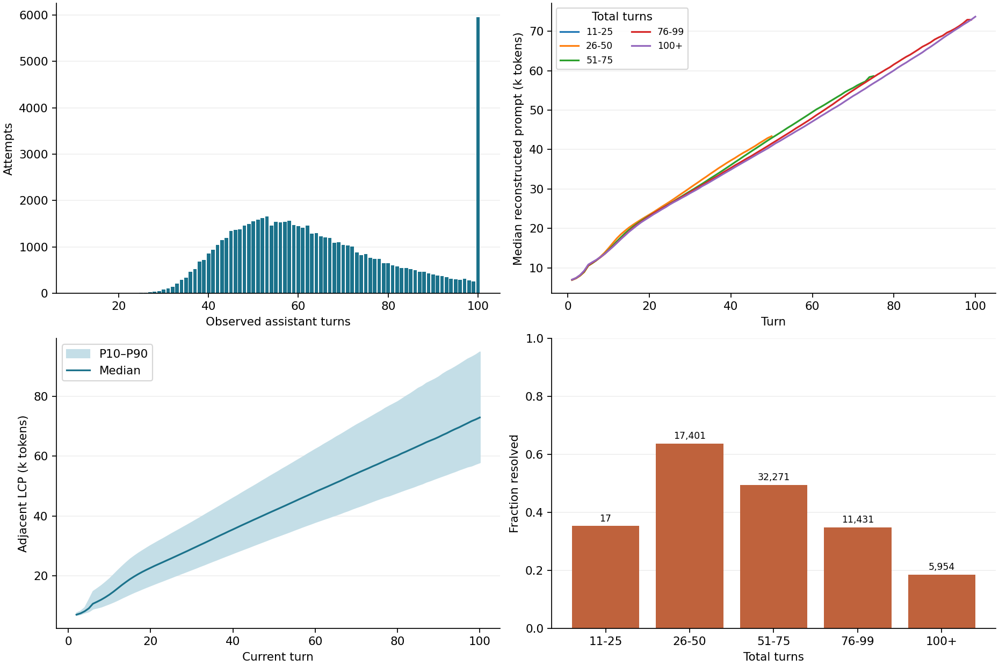

# Nebius OpenHands 公开轨迹的多轮上下文与 KV Cache 机会

## 主要发现

- **历史累积持续到长程执行末段。** 重建输入首轮中位数 6,959 tokens，末轮 50,606。相邻轮 Exact LCP 中位数 30,940，相邻轮共享比例中位数为 98.50%。
- **跨 Issue 共享公共头部，同 Issue 重试还共享任务文本。** 跨仓库、同仓库不同 Issue 和同 Issue 不同尝试的首轮 LCP 中位数分别为 5,816、5,825 和 6,962 tokens。
- **轨迹可构造深度差异显著的候选组。** 两个不同 Issue 的重建链可以共享头部并保留各自后缀。是否同时驻留、是否有释放压力、哪些候选在决策时合法，需要运行时证据。

## 数据与口径

分析固定版本 `35455389ab51bf5e2306bfd436ef72d0f98bf882` 的完整 `trajectories.parquet`（2,079,503,354 字节，CC BY 4.0）。轨迹由 OpenHands v0.54.0 使用 Qwen3-Coder-480B-A35B-Instruct 尝试解决 SWE-rebench 的 GitHub Issue 时产生。每行是一条执行尝试，即本报告中的一个 Program。独立 Issue 按 `(repo, instance_id)` 计数。整体分布按执行尝试加权，Issue 重试单独计数。[固定版本数据卡](https://huggingface.co/datasets/nebius/SWE-rebench-openhands-trajectories/blob/35455389ab51bf5e2306bfd436ef72d0f98bf882/README.md)

- **原始记录**提供有序消息、工具调用及结果、工具定义和执行结果标签。每条可见 Assistant 消息对应一个观测 Turn，消息之前的历史对应一次推定请求。失败且未产出消息的提交、隐式重试和运行时历史修改无法从发布文件计数。
- **重建输入**使用 Qwen 公共版本 `9d90cf8fca1bf7b7acca42d3fc9ae694a2194069` 的 tokenizer 和 chat template，为每个 Turn 渲染此前全部消息、该行工具定义及 Assistant generation prompt。按数据卡解析工具调用参数中的 JSON 对象，递归移除 Parquet 工具结构中的空槽位，空消息内容按空串渲染。发布格式无法区分工具结构中的空槽位和原始定义中的显式空值。脚本在 Assistant 特殊标记处分段编码，并以逐轮完整渲染与编码抽查 token IDs 等值。[固定版本 tokenizer 配置](https://huggingface.co/Qwen/Qwen3-Coder-480B-A35B-Instruct/blob/9d90cf8fca1bf7b7acca42d3fc9ae694a2194069/tokenizer_config.json)
- **运行时证据**未随数据发布。原始请求快照、提交 token IDs、跨 Program 到达时间、部署分片和缓存状态不可观测。公开配置使用 noop condenser，但逐请求截断、请求重写和缓存身份仍无法审计。[公开 OpenHands 配置](https://huggingface.co/datasets/nebius/SWE-rebench-openhands-trajectories/blob/35455389ab51bf5e2306bfd436ef72d0f98bf882/config.toml)

Exact LCP 从第一个 token 开始计数，直到相邻重建输入首次不同。Prefix Reuse Ratio 以当前输入的长度为分母。`当前长度 − Exact LCP` 包括新内容和重新进入非共享区的边界 token。净增长为当前长度减前一输入长度。Block 对齐取 `floor(LCP / block_size) × block_size`。各 Turn 的分位数使用到达该 Turn 的 Program。相对位置四分段按 `(Turn − 1) / Program 总 Turn` 划分。图中按总长度分组的曲线仅绘制每个位置至少有 30 条记录的点。

## 数据集结构

全量 67,074 行覆盖 6,306 个独立 Issue、1,823 个 Repository。每个 Issue 平均 10.64 次尝试，中位数 10，P90 15、P95 19、最大 34 次。只有 24 个 Issue 仅出现一次，最常见的是 7 次（966 个 Issue）。不同尝试可以有不同结果，有 3,792 个 Issue 至少解决一次，占 60.13%。该数字按 Issue 计，整表尝试解决率为 47.95%。

| 每个 Program 的可见 Assistant Turn | 最小 | 均值 | P50 | P90 | P95 | 最大 |
| --- | ---: | ---: | ---: | ---: | ---: | ---: |
| 次数 | 11 | 64.36 | 61 | 97 | 100 | 100 |

原始消息共有 4,316,962 条 Assistant、4,249,707 条 Tool、67,380 条 User 和 67,074 条 System。4,316,760 次工具调用平均每 Program 64.36 次。Bash 与编辑器合计占 93.09%。调用数来自结构化调用列表，一条 Assistant 消息可以包含多次调用。

| 工具 | 调用数 | 占比 |
| --- | ---: | ---: |
| `execute_bash` | 2,197,279 | 50.90% |
| `str_replace_editor` | 1,821,337 | 42.19% |
| `think` | 180,365 | 4.18% |
| `finish` | 60,749 | 1.41% |
| `task_tracker` | 57,030 | 1.32% |

核心字段完整，所有 `resolved` 均为 0 或 1。测试评估字段 `gen_tests_correct` 和 `pred_passes_gen_tests` 分别有 35,621 和 35,685 个空值。空 patch 56 条。重复 `trajectory_id` 0 条，同 Issue 内规范化对话与工具定义一致的额外记录 0 条。规范化比较忽略工具调用 ID，保留角色、内容、调用名和解析后的参数。全量统计保留原始执行尝试。

工具日志中 4 条 Assistant 消息包含多个调用，206 条没有调用。有 67,053 次调用在本行没有匹配的 Tool Result，涉及 67,053 条尝试。每条工具结果均匹配到此前的调用。发布轨迹均以 Assistant 消息结束，终止动作和轨迹边界都可能留下无匹配的调用。Token 重建覆盖 67,074 条尝试和 4,316,962 个输入，其中 28 条尝试用逐轮完整渲染验证了分段编码一致性。



## 执行结果

`exit_status` 表示结束方式，`resolved` 是数据集的验收结果。提交轨迹中 51.07% 解决，其他状态中 18.01% 解决。两个口径的差异主要来自 29,719 次未解决的提交以及 1,093 次达到迭代上限但仍通过验收的尝试。

| 结束方式 | 未解决 | 已解决 | 合计 |
| --- | ---: | ---: | ---: |
| `submit` | 29,719 | 31,020 | 60,739 |
| 达到 100 次迭代上限 | 4,910 | 1,093 | 6,003 |
| 卡在循环 | 232 | 20 | 252 |
| API 超时 | 19 | 17 | 36 |
| 服务不可用 | 22 | 7 | 29 |
| `unknown` | 7 | 3 | 10 |
| `AttributeError` | 4 | 1 | 5 |
| **合计** | **34,913** | **32,161** | **67,074** |

| 可见 Turn | 尝试 | 已解决 | 解决率 | 已解决末轮 P50 | 未解决末轮 P50 | 已解决 / 未解决调用 P50 |
| --- | ---: | ---: | ---: | ---: | ---: | ---: |
| 11-25 | 17 | 6 | 35.29% | 24,235 | 25,490 | 25 / 23 |
| 26-50 | 17,401 | 11,108 | 63.84% | 38,266 | 40,137 | 44 / 45 |
| 51-75 | 32,271 | 15,959 | 49.45% | 48,664 | 51,397 | 60 / 62 |
| 76-99 | 11,431 | 3,983 | 34.84% | 62,801 | 66,167 | 84 / 85 |
| 100+ | 5,954 | 1,105 | 18.56% | 71,065 | 74,237 | 100 / 100 |

总体上，已解决与未解决尝试的 Turn 中位数分别为 56 和 67，末轮输入中位数为 46,780 和 54,966 tokens，末轮输入 P90 为 68,021 和 80,642。已解决和未解决尝试初始输入的中位数分别为 6,953 和 6,966。各长度组的已解决尝试末轮输入中位数都更短，末轮中位数差距在三个规模最大的组内为 1,871–3,366 tokens。11–25 轮样本只有 17 条，100 轮组受迭代上限影响。长尝试的较低解决率是描述性关联，可能同时受任务、提前结束和结束方式影响。

| 工具 | 已解决每尝试均值 | 未解决每尝试均值 | 已解决调用占比 | 未解决调用占比 |
| --- | ---: | ---: | ---: | ---: |
| `execute_bash` | 30.39 | 34.94 | 51.44% | 50.48% |
| `finish` | 0.96 | 0.85 | 1.63% | 1.23% |
| `str_replace_editor` | 24.38 | 29.71 | 41.26% | 42.92% |
| `task_tracker` | 0.75 | 0.94 | 1.27% | 1.36% |
| `think` | 2.60 | 2.78 | 4.39% | 4.01% |

按尝试看，调用中位数为 56 对 67。按可见 Turn 看，调用密度分别为 1.0000 和 0.9999 次/轮。调用总量比较与执行长短相关。终止工具的占比也与执行结束方式有关。

## 多轮上下文与 Prefix Reuse

| 重建输入指标 | 样本数 | P50 | P90 | P95 | 最大 |
| --- | ---: | ---: | ---: | ---: | ---: |
| 每轮输入 | 4,316,962 | 31,256 | 56,822 | 65,454 | 127,991 |
| 首轮输入 | 67,074 | 6,959 | 7,620 | 8,108 | 22,825 |
| 末轮输入 | 67,074 | 50,606 | 75,573 | 84,554 | 127,991 |
| Program 净增长 | 67,074 | 43,453 | 68,264 | 77,207 | 121,158 |

| 当前 Turn | 到达该轮 | 输入 P50 | 相邻 LCP P50 | 非共享 token P50 | 新增消息 P50 |
| --- | ---: | ---: | ---: | ---: | ---: |
| 25 | 67,065 | 26,395 | 25,764 | 453 | 2 |
| 50 | 51,213 | 42,405 | 41,761 | 458 | 2 |
| 75 | 18,227 | 57,846 | 57,190 | 461 | 2 |
| 100 | 5,954 | 73,688 | 72,928 | 487 | 2 |

26–50 轮组末轮输入中位数为 38,962，100 轮组为 73,688，相邻 LCP 中位数分别为 24,468 和 40,808。相邻的 4,249,888 对输入中，净增 token 的 P50 / P90 / P95 为 461 / 1,411 / 2,093。非共享 token 对应值为 461 / 1,411 / 2,093。每轮新增消息中位数 2，其中典型轮包含上一条 Assistant 消息和一个工具结果。

按两个可见请求之间的原始字符串计，Tool Result 占新增内容字符的 76.43%，Tool Call 的序列化参数占 18.54%，Assistant 正文占 5.03%，其余消息占比低于 0.01%。含调用区间平均增加 732.7 tokens，无调用区间为 1,072.3，后者只有 185 个。字符占比是对原始内容的归因。Token 增量来自实际渲染，包含模板标记、转义和调用标签。

| Program 内相对位置 | 相邻对数 | 输入 P50 | Exact LCP P50 | Reuse Ratio P50 | 非共享 token P50 |
| --- | ---: | ---: | ---: | ---: | ---: |
| 第 1 四分段 | 1,035,149 | 13,942 | 12,995 | 96.38% | 458 |
| 第 2 四分段 | 1,071,521 | 26,947 | 26,304 | 98.37% | 437 |
| 第 3 四分段 | 1,086,906 | 37,759 | 37,089 | 98.69% | 489 |
| 第 4 四分段 | 1,056,312 | 49,462 | 48,799 | 99.07% | 460 |

Exact LCP 的 P50 / P90 / P95 为 30,940 / 56,296 / 64,857 tokens，按 token 加权的相邻共享比例为 97.83%。模型输入在工具交互后增加的内容通常只占较小一段。由于重建保留完整历史，高 LCP 反映这套追加式输入口径以及实际增量相对历史的大小。逐轮重建无法检测原运行时可能发生的改写。

| Block 大小 | 可复用 token P50 | P90 | 平均对齐损失 |
| --- | ---: | ---: | ---: |
| 16 | 30,928 | 56,288 | 7.5 |
| 32 | 30,912 | 56,288 | 15.5 |
| 64 | 30,912 | 56,256 | 31.5 |
| 128 | 30,848 | 56,192 | 63.5 |

## 跨 Program 共享

只比较每条轨迹的首个重建输入，以免把任务过程中的不同进度混入跨 Program 共享。每个关系从符合条件的无序尝试对中等概率有放回抽取 20,000 对，固定随机种子 35455389。高重试数 Issue 在尝试对总体中权重更高。

| 尝试之间关系 | 可选对数 | LCP P50 | LCP P90 | LCP / 当前输入 P50 | 相同 System | 相同 Tool Schema | 相同首条 User | 相同完整首轮 |
| --- | ---: | ---: | ---: | ---: | ---: | ---: | ---: | ---: |
| 跨仓库、跨 Issue | 2,240,312,713 | 5,816 | 5,816 | 83.55% | 100.00% | 100.00% | 0.00% | 0.00% |
| 同仓库、不同 Issue | 8,737,988 | 5,825 | 5,829 | 83.26% | 100.00% | 100.00% | 0.01% | 0.01% |
| 同 Issue、不同尝试 | 376,500 | 6,962 | 7,635 | 100.00% | 100.00% | 100.00% | 99.96% | 99.96% |

重建中有 1 种完整 System Prompt、1 种 Tool Schema 定义和 1 种组合。单独渲染 System 段中位数 2,338 tokens，加入工具定义和工具调用格式说明以后，头部中位数为 5,808，配对增量中位数 3,470。在完整头部相同的样本中，头部之后的 LCP 中位数在三个关系下分别为 8、17、1,154 tokens。跨 Issue 的这部分仍可包含共同的 User 模板文字。同 Issue 的完整首轮匹配是任务文本可跨重试复用的直接重建证据。只要保留首轮历史，公共任务内容就继续出现在后续输入开头。进一步共享的长度取决于工具调用和结果何时分歧。

按 16-token block 对齐，首轮可共享长度中位数在三个关系下分别为 5,808、5,824、6,960 tokens。这些分布涵盖可能形成同一缓存身份的内容。部署路由、命名空间和驻留时间决定它们是否有机会进入同一缓存。

## KV Cache 机会

**持续复用与成本差异。** 相对位置分段显示，长程 Program 在后段仍能复用此前的绝大部分重建输入。短 Program 同样有高比例的历史复用，其绝对深度较浅。相邻 LCP 的 P10 是 11,616 tokens，P90 是 56,296 tokens，相差 4.8 倍。在早期和后期请求、短程和长程 Program 混合的缓存压力窗口中，有理由把可丢失的后缀 token 量和前缀深度作为两个单独的成本变量。实际 GPU 重算还取决于最深的存活祖先、批处理和硬件。

**可以构造两个独立后缀。** 按 Parquet 行序在同一完整头部下对不同 Issue、不同首条 User 的多轮 Program 配对，每条尝试最多进入一对，取各自最后一次相邻 LCP，再扣掉两者共有且按 16 tokens 对齐的祖先。共有 33,534 对在两条链上均保留至少一块独占可复用后缀，33,522 对的对齐前缀深度不同，33,534 对两边均有至少 256 个独占块。每对较短和较长独占尾部的中位数为 36,992 和 53,792 tokens，深度差中位数 14,304，P90 38,032。配对依赖归档顺序，描述可构造性，没有估计自然并发频率。

在显式交错回放中，可把这两条 Program 在各自末轮前暂停，把共有祖先保留在缓存，并设置第三个请求造成容量压力。如果两条独占尾部均驻留、分别由不同 Entry 保护、无活动引用，且释放任意一个 Entry 都足以满足压力，就得到两个几何上可区分的条件候选。这些条件需要执行证据。此前 Phase 3 A3 的 127 个实际决策中仅 7 个有两个合法候选。公开轨迹扩大了可供构造的长度、共享和独占尾部分布，由于数据源没有可对齐的决策窗口，目前无法比较合法候选暴露率或可避免损失。[Phase 3 算法暴露审计](../../experiments/phase3-algorithm-exposure-audit.md)

**对 Cost-Aware 研究的用途。** 这套数据足以用于基于全量分布选择不同长度、不同共享层级和不同独占尾部厚度的工作负载，并预先声明交错与压力设置。下一步可在独立的回放研究里验证两种释放选择能否通过合法性检查，以及它们会不会改变后续物理受害块和边际重算量。需要观察实际输入身份、引用计数、同租户驻留、压力大小、受害块以及后续请求。Prefix Reuse Ratio 度量本地重建输入中的共享内容。真实 Cache Hit、淘汰次数、重算时延和 Cost-Aware 相对 LRU 的收益没有观测值。

## 复现

运行使用 Python 3.13、pandas 2.3.0、NumPy 2.1.2、pyarrow 26.0.1、Matplotlib 3.10.3、Jinja2 3.1.6 和 tokenizers 0.23.3。下载固定版本的 [Parquet](https://huggingface.co/datasets/nebius/SWE-rebench-openhands-trajectories/resolve/35455389ab51bf5e2306bfd436ef72d0f98bf882/trajectories.parquet)、[tokenizer.json](https://huggingface.co/Qwen/Qwen3-Coder-480B-A35B-Instruct/resolve/9d90cf8fca1bf7b7acca42d3fc9ae694a2194069/tokenizer.json) 和 [tokenizer_config.json](https://huggingface.co/Qwen/Qwen3-Coder-480B-A35B-Instruct/resolve/9d90cf8fca1bf7b7acca42d3fc9ae694a2194069/tokenizer_config.json) 到同一本地目录。在仓库根目录运行以下命令。

```powershell
python -m pip install pandas==2.3.0 numpy==2.1.2 pyarrow==26.0.1 matplotlib==3.10.3 jinja2==3.1.6 tokenizers==0.23.3
$data = "C:/data/nebius-openhands"
python scripts/analyze_nebius_openhands.py "$data/trajectories.parquet" "$data" --output "$data/results" --workers 9
```

[全量汇总](nebius-openhands/summary.json) · [Turn 分组](nebius-openhands/turn_bands.csv) · [每个 Issue 的尝试次数](nebius-openhands/issue_attempts.csv) · [逐轮统计](nebius-openhands/turn_profile.csv) · [执行结果交叉表](nebius-openhands/outcomes.csv)
