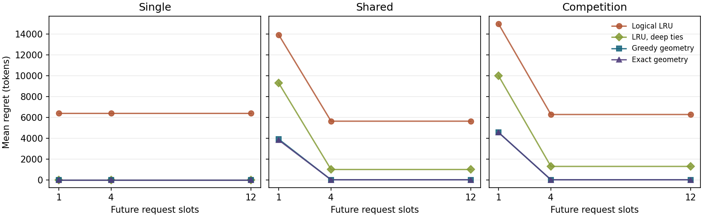

# 公开工作负载成本几何与 Offline Downstream Recompute Oracle

## 主要发现

- **公开链有显著结构差异。** Qwen2.5 的跨仓首轮 LCP 中位数 5,715 tokens，同 Issue 6,849.5。Turn 24 同 Issue 和跨 Issue 场景的共有块中位数分别为 430 和 357（16 tokens/block）。候选的几何差异来自共有祖先、独占尾部和位置。
- **等量淘汰可产生大额反事实差异，比较对象决定大小。** 两 Program 均返回的 12 槽竞争场景中，浅层并列 logical LRU 的平均 regret 为 6,280 tokens，改用深层并列后为 1,286，当前几何穷举代理为 0。单链场景中，深层并列已消除全部 regret。
- **谁先返回会改变近窗的最优选择。** 竞争场景只观察下一槽时，旋转首返顺序使 logical LRU 的平均 regret 从 15,000 变为 0 tokens。同一个几何代理在两个顺序下均有非零 regret。这里没有真实跨 Program 到达时序。

## 数据、前缀和目标 Runtime

来源为 Nebius OpenHands 固定 Parquet 版本 `35455389ab51bf5e2306bfd436ef72d0f98bf882`。公开数据记录有序消息、工具调用、工具定义和结束方式。每条可见 Assistant 消息前的历史是一次推定请求，Program 对应一条执行尝试，Issue 对应公开问题。Serving Session 身份不可独立识别。原始运行时输入 token IDs、物理块、租户与 hash namespace、时间戳、排队、服务和物理驱逐均缺失。[初始全量分析](Nebius-OpenHands-Trajectories.md)

- **原字段构造的文本级 LCP**以 Parquet 的 `tools`、各 role 的原始字段及其顺序序列化为 JSON 文本，计算 codepoint LCP。表示层本身由脚本定义，字符边界受 JSON 键顺序影响。
- **重建 token LCP**分别用 Qwen3-Coder-480B-A35B-Instruct `9d90cf8…` 和 Qwen2.5-Coder-1.5B-Instruct `d18ecad…` 自己的公开 tokenizer 与模板渲染。两者接收相同的结构化消息，解析 JSON 工具参数，移除 Arrow 空槽位，并附生成提示。Qwen2.5 使用自己的 JSON 工具调用模板。保留两套计量口径，原 Qwen3 token 数不直接迁移到目标 Runtime。
- **逻辑 block LCP**以 `(parent block identity, block token IDs)` 精确构建路径，每轮丢去不足一块的尾部。两个不同父链中的同 token block 仍有不同身份。块大小为 16、32、64、128 tokens。
- **Native APC 命中**取决于运行时身份、cache salt、内容、驻留、refcount、eligible pool 及同一 cache 实例。公开轨迹无该证据。目标参考是 Phase 5 记录的 Qwen2.5-Coder-1.5B-Instruct `d18ecad…`、16 tokens/block、32,768 context、预留生成 128 tokens。逻辑投影同时报告 32,640 输入上限覆盖。超限记录仍参与逻辑敏感性分析。它们需要独立的上下文方案才可用于有此预算的 Native Replay。[Phase 5 配置](../../../configs/phase5/phase5-formal-protocol-v1.json)

先全量核对身份和端点。主样本按固定 SHA-256 排序从有重试的 Issue 取 128 个锚点，每个锚点取两次尝试；为每簇另配一个未使用的不同 Issue 和一次尝试。依簇序交替优先同仓和跨仓，同仓不可用时采用跨仓。共 256 个互异 Issue、384 次尝试。抽样只读身份，独立于结束状态、内容和 Oracle 损失。分析以构造簇为单位，控制同 Issue 的重试相关性。该定向样本描述指定场景，不能估计自然并发或合法候选的总体频率。逐条身份和同仓标志见 [issue_clusters.csv](evidence-results/issue_clusters.csv)。

| 首轮配对关系 | 簇 | 原字段 JSON 字符 LCP P50 | Qwen3 渲染字符 LCP P50 | Qwen3 token LCP P50 | Qwen2.5 渲染字符 LCP P50 | Qwen2.5 token LCP P50 | Qwen2.5 按 16 对齐 token P50 |
| --- | ---: | ---: | ---: | ---: | ---: | ---: | ---: |
| 跨仓不同 Issue | 70 | 27,514 | 27,565.0 | 5,816.0 | 26,710.0 | 5,715.0 | 5,712 |
| 同仓不同 Issue | 58 | 27,537 | 27,588.0 | 5,826.0 | 26,733.0 | 5,725.0 | 5,712 |
| 同 Issue 重试 | 128 | 32,180 | 32,105.5 | 6,950.5 | 31,250.5 | 6,849.5 | 6,840 |

首请求中位数在 Qwen3 与 Qwen2.5 分别为 6,929 和 6,828 tokens。PR #135 全量核对均采用模型公开模板，跨 Issue 的 5,800 左右主要来自共同头部。相同 Issue 常保留整个任务提示。到 Turn 24，两个投影的请求中位数变为 25,333.5 和 25,352.0 tokens，Qwen2.5 相对上一轮新增中位数 446.5，Exact LCP 中位数 24,756 tokens。PR #135 的 [逐轮生长曲线](nebius-openhands/turn_profile.csv) 补充了完整 Qwen3 范围。

Qwen2.5、16-token block 下，Turn 24 的单链长度 P50 为 1,573.5 块。共享场景当前每簇链长均值的 P50 为 1,595 块，共享祖先 P50 为 430 块，较短独占尾部 P50 为 1,005.5 块。不同 Issue 竞争场景对应为 1,615.25、357、1,058 块。共有祖先有两个逻辑成员。候选池使用其两个深度位置仅限共享场景。独占尾部候选的深度覆盖约 25%、50%、75% 分位位置。

## 反事实状态和实现

在已见 Turn 24 的决策点，以各参加者该轮完整 prompt blocks 的并集作为同一只读初态。只加入 prompt 的完整块。生成后的 token 没有自动预热。逻辑模拟假定同命名空间、选定候选均可淘汰；无 Native 并发、引用计数或所有权推定。

| 场景 | 初态 | 候选和相同预算 |
| --- | --- | --- |
| 单链 | 一个 Program | 取链内约四分之一、二分之一、四分之三位置，等量淘汰两块 |
| 共享链 | 同一 Issue 两次尝试 | 共享链中点、末点加上两条独占尾部各三个分位深度；枚举所有两块集合 |
| 多 Program 竞争 | 不同 Issue 两条链 | 保护实验中共同祖先，只从每条独占尾部各取三个分位深度；枚举所有两块集合 |

候选深度由研究设计取样。基准 logical LRU 用固定预热顺序 A 后 B 的最末触碰排序，同一触碰用浅到深打破并列。另保留相同合法集合和触碰顺序，改用深到浅的敏感性对照。真实 Native free queue 未进入排序。共享和竞争场景用交替请求槽，并分别让 A、B 先返回。窗口是 1、4、12 个槽，无秒级含义。已提交轨迹结束后保留空槽。有非提交中断导致窗口不足时整格记作删失。没有第 24 轮则该场景无可证实的初态，清单记录原因。候选退化同样记录。只使用未来真实可见的 ordinal 与内容评估损失。

记无额外淘汰臂在第 `r` 个请求前的连续居民前缀为 `E_r`。淘汰集合 `S` 后的臂用同一条父链逐块查找，在首个不在缓存的块处得到 `C_r(S)`。读取后，两臂都回填此请求所有完整块，包括可重新建立的祖先和后缀。一次干预之后不另施压力，并保持固定请求序列。因而 `Loss_future(S,t,H) = B × Σ_r [E_r − C_r(S)]`，其中 `B` 是每块 token 数。`E` 和 `C` 均以 block 计。回填后同一缺块不被重复收费。共享祖先首先被需求的请求会填回祖先，但不会无条件填回其他分支的独占尾部。实现共享基准回填状态，利用两臂差集在处理每个请求后只可能缩小的性质计算等价结果。该有限场景 Oracle 衡量增量 token 重算。没有模拟服务端尾 token 的额外重算要求、持续压力、跨层转移、队列、终止因果效应或 Native 物理驱逐。

| 信息 | 代理策略 | 事后 Oracle |
| --- | --- | --- |
| 当前链、共享成员、合成 rank、预算 | 允许 | 允许 |
| 当前 Native rank、deadline、TTL、refcount、profile、armed follow-up | 若可信观测方可使用，本数据缺失 | 本研究未填补 |
| 未来请求、是否返回、实际终止标签 | 禁止。只用结束标签识别窗口缺失 | 允许用于事后评分及删失 |

**动作与损失比较。** Logical LRU、单位权重边际 Greedy、同一静态几何的穷举最优以及 Hindsight Oracle 共用候选和预算。静态几何按全部当前链计算最浅被移除块以下的后缀和，单位权重避免将缺失的时间代理填入正式 A2。Hindsight 在有限候选集精确枚举，使 future loss 最小。Regret 是候选所获损失与其差，avoidable loss 用 logical LRU regret 表示。动作分歧等于集合不一致，结果差异以每簇最大与最小未来损失之差、以及 regret 是否为正衡量。排名一致率只比较 Oracle 损失不同的集合对，静态代理并列记半分。两种等预算的合成 Entry 释放另做成对比较，每侧取该侧独占候选 rank 的前两块。它们用同一两种 release 选项对比固定顺序、绝对后缀和 `S/m` 两个代理。

## 反事实结果

每种主场景有 128 个簇，完整 15,360 个分场景、block size、模板、顺序及窗口的评价格。没有缺 Warm 轮、候选退化或删失窗口，清单仍保留排除字段。64/128 等设置与 16 使用相同块数预算，耗费的 token 容量不同。以下主表固定 Qwen2.5、16 tokens/block、A 先返回、12 槽，单位 tokens。每簇均为同候选配对。括号是簇 bootstrap 的 95% 百分位区间，范围限于抽取的配对与场景。

| 场景 | 候选块 / 两块方案 | Oracle 平均损失 | 最大−最小平均损失 | Logical LRU 平均 regret | LRU 深层并列 regret | 几何 Greedy regret | 几何 Exact regret |
| --- | ---: | ---: | ---: | ---: | ---: | ---: | ---: |
| 单链 | 3 / 3 | 12,863 | 6,423 | 6,423（6,198–6,639） | 0.0 | 0.00 | 0 |
| 共享链 | 8 / 28 | 8,321 | 27,729 | 5,636（5,214–6,031） | 988.8 | 0.13 | 0 |
| 不同 Issue 竞争 | 6 / 15 | 8,720 | 21,777 | 6,280（5,799–6,788） | 1,285.5 | 0.00 | 0 |



用同一触碰顺序将组内并列改为深到浅后，单链损失差完全由位置顺序消化，共享链与竞争平均 regret 仍分别为 988.8 和 1,285.5。因此以初始浅到深的假设推导的空间偏大。两种 logical LRU 均使用构造 rank，实际 Native 比较保持缺失。12 槽的前向共享与竞争场景中，浅层并列基准每簇 regret 均为正，几何 Exact 皆为零。Qwen2.5 的贪心仅在共享场景一簇高出 Exact 16 tokens，且在共享场景以外没有静态穷举差距。静态模型的 pairwise ranking agreement 在竞争为 100.0%、共享为 85.0%。共享祖先在先到请求回填可改变其他方案的相对顺序，即使最优集合仍一致。

在 1 槽竞争中，A 先返回时 logical LRU 损失 15,000，几何 Exact regret 4,556。B 先返回时对应 0 和 4,164。Hindsight 可在未返回一侧选择同预算 victim，所以该槽 Oracle 最小值为零。两边返回以后，4 和 12 槽的增量结果相同，符合单次干预且首次可达即回填的设计。未来次序可用作 Oracle 标签，不能在代理决策时选择待淘汰侧。

将候选全部两块集合中的单块代价和联合成本比较。在单链、共享与竞争场景中，给两块中影响更大的那块再加另一块，有 100.0%、67.9%、40.0% 的联合静态代价不再增加。竞争场景在 16、32、64、128 块大小下平均浅层并列 regret 分别为 6,280、6,279、6,271、6,270 tokens，说明该演示的深度效应并非 16-token 对齐特例。Qwen3 的同条件竞争均值为 6,262。

Qwen2.5 的 384 个 Warm 输入里有 51 个超 32,640 tokens。12 槽全程适配该预算的单链、共享、竞争分别为 60、76、59/128。在适配的竞争簇内，浅层与深层并列的平均 regret 分别为 5,241 和 972，几何 Exact 为零。这是事后预算子集，不能视为在线调度特征。

合成 Entry 两选项的 `S/m` P10–P90，在共享场景为 0.474–0.593，竞争为 0.527–0.622。竞争 12 槽下，两选项的平均未来损失差 4,353 tokens，对固定先选 A、绝对后缀和比例代理的平均 regret 分别为 1,927.9、0.0、0.0。比例代理在 49.2% 的簇换选，其中全体的 0.8% 换选却没有改善。对 1 槽 B 先返回，比例代理的 49.2% 换选均未改善，说明 suffix 差异不能省去 follow-up 条件。

## A2 与 A3 的分歧条件

A2 的结构项是 `Σ_c q_c(m_c−j_c(S)+1)`。真实内容可以出现多个当前链共享一个块，移除祖先可阻断两个逻辑路径。若先移除祖先，再移除目前已被祖先遮蔽的下游块，静态边际可降至零。未来回填后，共享祖先的损失可能只发生在首个到达的程式。其余分支后续独占块仍可能失效。这个贡献误差可在没有 `q` 估计的情况下出现。

A3 的可观测结构项为 `S/m`。合成角色 A、B 中，若两侧 `S/m` 非零，A 风险分数更小的条件是 `(q_A·prefill_A)/(q_B·prefill_B) < (S_B/m_B)/(S_A/m_A)`。清单只给阈值分布及几何代理的分歧，真实 deadline 和 profile 不可观测。Phase 1B 短前缀、不同服务环境的 PrefillReload profile 不适用于此目标投影。真实 A1 的 sufficient-first 阶梯、A2 权重和 rank、A3 的公式输入、DVA-ER 的完整 Native 两级队列及 armed follow-up 条件均需要独立运行态证据。

| 策略 | 状态 | 需要补齐的输入 |
| --- | --- | --- |
| Native LRU | NOT_EVALUABLE | 决策时真实 rank、free queue、可淘汰块与同一物理身份 |
| A1 | NOT_EVALUABLE | 合法 Entry、真实压力、可新增 eligible、deadline 和 TTL |
| A2 | NOT_EVALUABLE | Native rank、权重、合法集合、受害块物理身份 |
| A3 | NOT_EVALUABLE | A1 输入、可验证的链深与物理 victim 预测、可用 PrefillReload profile |
| DVA-ER | NOT_EVALUABLE | 完整 Native 队列、双层资格、真实所有者、已 armed 时间与 A0 次序 |
| 有限候选 Hindsight Oracle | EVALUATED_COUNTERFACTUAL | 预注册槽和后续公开输入，允许事后使用 |

## 数据清单与复现

[清单](evidence-results/manifest.json) 包含输入链接、版本、每个数据文件的 SHA-256、字节数、代码 commit、block size、窗口、样本/排除计数、分段编码校验以及派生文件 SHA-256。原始 Parquet 与两个 tokenizer 目录留在本地。生成文件只保存分层统计、可追溯的匿名公开尝试身份及图表，运行没有落盘缓存原始输入或 token 序列。需要 Python 3.13、pandas 2.3.0、NumPy 2.1.2、PyArrow 26.0.1、Matplotlib 3.10.3、Jinja2 3.1.6、tokenizers 0.23.3 与测试用 pytest。将清单中的 Parquet 和两组同名 tokenizer 文件放到各自本地目录，然后在仓库根目录运行。

```powershell
python scripts/analyze_public_workload_evidence.py C:/data/nebius/trajectories.parquet C:/data/qwen3 C:/data/qwen25 --output C:/data/public-evidence-results
python -m pytest -q tests/test_public_workload_oracle.py
```

代码运行读取当前 HEAD 写入清单。若需要逐字节核对清单中的代码身份，使用该 commit 复现。从其他包含相同实现的 commit 复现时，会记录当时的 HEAD。结果由 [geometry.json](evidence-results/geometry.json)、[oracle_summary.csv](evidence-results/oracle_summary.csv) 和 [memoryfulness.json](evidence-results/memoryfulness.json) 提供。
