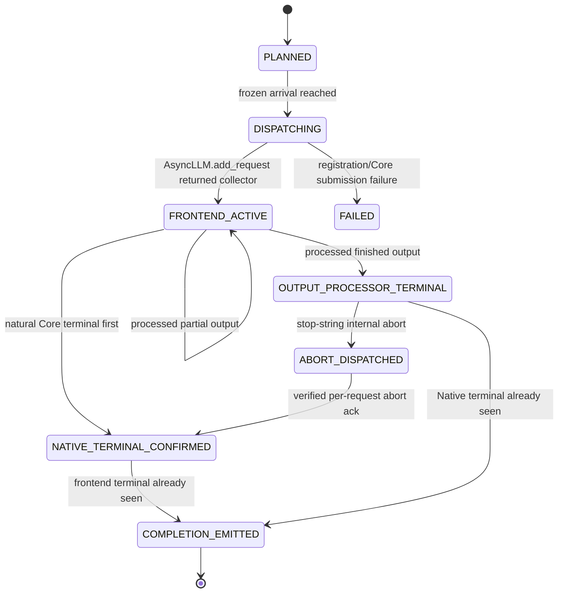

# Phase 5D AsyncLLM Native Adapter Report

**Status:** CPU/Mock implementation complete; GPU Conformance and Trace
Acquisition were not executed.

**Base commit:** `86ac503cda2d538090477440c9b1303f8fafba44`

## 1. Scope and result

Phase 5D implements a version-locked adapter for the approved vLLM 0.27.1
`AsyncLLM + RequestOutputCollector` path. The implementation does not use
`LLM.enqueue()`, `wait_for_completion()`, a global drain, a second EngineCore
output consumer, or a replacement OutputProcessor.

The CPU result is **READY_FOR_CODE_REVIEW**. It is not GPU Conformance. One
important runtime condition remains deliberately fail-closed: vLLM's async
abort call proves that the abort message was sent, but the audited public
surface does not itself prove that EngineCore has processed that abort and
released the request. A later GPU validation must provide an independently
verified per-request abort-confirmation hook. Without that hook, stop-string
conformance remains `NOT_READY`.

## 2. Implemented components

`src/kvopt/workload/phase5_asyncllm_adapter.py` adds:

- `AsyncLLMNativeAdapter`, which submits each request with
  `AsyncLLM.add_request` and owns one task for the returned
  `RequestOutputCollector`;
- a strict vLLM `0.27.1` version and coroutine-surface check;
- separate frontend-terminal and Native-terminal landmarks;
- incremental completion release only after both terminal landmarks exist;
- explicit dispatch, Native submission, scheduler, output, abort and terminal
  evidence with non-interchangeable clock domains;
- cleanup paths for dispatch failure, collector failure and shutdown;
- frontend RequestState leak checks through the pinned OutputProcessor lookup
  seam; and
- `PinnedEngineCoreLifecycleProxy`, a narrow observer around the same
  `get_output_async()` stream already consumed by AsyncLLM's single output
  handler.

The proxy passes every Core batch through unchanged. It observes natural Core
terminal outputs and abort dispatches. It does not replace the Scheduler,
OutputProcessor, BlockPool, cache policy or Native KV ownership. In particular,
an observed abort dispatch remains `confirmation=PENDING`.

## 3. Dual terminal lifecycle



The diagram represents two independent facts rather than one linear state
variable:

1. `OUTPUT_PROCESSOR_TERMINAL` means vLLM's frontend has emitted a terminal
   `RequestOutput` after detokenization and stop-string processing.
2. `NATIVE_TERMINAL_CONFIRMED` means natural Core termination or a separately
   confirmed abort has closed the Native request lifecycle.

Frontend terminal, abort dispatch and abort-call return do not release Phase 5
inflight capacity. Only the conjunction of frontend terminal and Native terminal
produces a `RequestCompletion`.

## 4. AsyncLLM integration boundary

The adapter calls the real interface shape:

```text
collector = await AsyncLLM.add_request(
    request_id=<stable native id>,
    prompt=<explicit-token prompt>,
    params=<frozen sampling params>,
    arrival_time=<adapter dispatch timestamp>,
)
output = await collector.get()
```

The collector task reads only processed `RequestOutput` values. It does not read
EngineCore output directly. The optional Core proxy wraps the existing
`engine_core.get_output_async()` call in place, records terminal evidence, and
returns the identical object to AsyncLLM. There is still exactly one Core-output
consumer.

The proxy also observes `abort_requests_async()`. That observation establishes
only `NATIVE_ABORT_DISPATCHED`. The code exposes an explicit
`confirm_native_terminal(..., ABORT_CONFIRMED, ...)` seam for a future verified
runtime acknowledgement; it never promotes dispatch return to confirmation.

## 5. Timing and evidence contract

The evidence ledger distinguishes:

| Evidence | Clock domain | Meaning |
|---|---|---|
| `PLANNED_ARRIVAL` | adapter native monotonic | frozen epoch plus logical offset |
| `ADAPTER_DISPATCH_STARTED/RETURNED` | adapter native monotonic | client/API operation |
| `NATIVE_SUBMISSION_OBSERVED` | EngineCore monotonic | independently observed Core identity |
| `NATIVE_SCHEDULER_OBSERVED` | EngineCore monotonic | queued and scheduled timestamps |
| `OUTPUT_PROCESSOR_PARTIAL/TERMINAL` | adapter native monotonic | processed frontend output |
| `NATIVE_ABORT_DISPATCHED` | adapter native monotonic | message sent; no acknowledgement implied |
| `NATIVE_TERMINAL_CONFIRMED` | EngineCore monotonic | natural terminal or verified abort ack |
| `ADAPTER_COMPLETION_EMITTED` | adapter native monotonic | both terminal facts present |

Cross-domain subtraction is prohibited. Completion emission uses the adapter
clock at the moment both facts are known; it does not compare adapter and
EngineCore timestamp magnitudes. Planned arrival lateness, actual Native enqueue
order and queued/scheduled timing remain separate conformance checks.

## 6. Failure and cleanup semantics

- **OutputProcessor registration/Core submission failure:** record dispatch
  failure, invoke internal abort rollback and require no remaining frontend
  RequestState.
- **Collector failure:** mark the adapter fatal, dispatch internal abort and
  reject completion polling. It is not converted into successful completion.
- **Stop string:** observe frontend terminal and internal abort dispatch, then
  wait for explicit Native confirmation.
- **Explicit abort:** await abort dispatch but do not infer confirmation.
- **Shutdown:** abort every unresolved request, close collectors, cancel and join
  collector tasks, check frontend state and report missing Native confirmation.
- **Duplicate/unknown evidence:** fail closed.

The adapter report exposes task completion, outstanding terminal facts, failure
reason and the complete ordered event ledger. Shutdown is idempotent after its
first invocation.

## 7. CPU/Mock verification

`tests/test_phase5_asyncllm_adapter.py` covers:

1. partial and frontend-terminal outputs do not release capacity;
2. Native terminal before or after frontend terminal;
3. stop-string abort dispatch without acknowledgement;
4. abort confirmation without prior abort dispatch;
5. registration/Core submission rollback;
6. collector/pump failure and abort cleanup;
7. shutdown task cancellation and missing-confirmation failure;
8. two overlapping requests with out-of-order terminal completion;
9. separate adapter and EngineCore timing domains;
10. pinned version and rejection of batch drain;
11. same-stream Core proxy natural-terminal observation; and
12. abort proxy observation without false confirmation.

The Phase 5A/5B/5C contracts remain unchanged. No production eviction algorithm,
Protocol v4, historical Cohort or sealed experiment result is modified.

## 8. Multi-Program GPU Conformance fixture contract

A later, separately authorized fixture must reuse the Phase 5A workload seal and
Phase 5B event-driven controller with:

- at least four independent Programs;
- explicit token IDs and stable Program/request identities;
- at least one frozen arrival tie;
- bounded inflight capacity of at least two;
- one live-state or quiescent Pressure boundary with an explicit contract;
- at least one later request dispatched before an earlier request reaches either
  terminal landmark;
- complete actual Native submission order; and
- natural-terminal plus stop-string/abort paths.

The fixture remains a preparation contract, not an authorized GPU input. It must
be sealed only after M1 approves GPU Conformance; Phase 5D does not create a
synthetic authorization or claim a GPU result.

## 9. GPU Conformance entry conditions

GPU Conformance should be requested only after all of the following hold:

1. pinned 0.27.1 source/signature audit passes on the target environment;
2. exact Adapter and EngineCore proxy surface checks pass;
3. the existing Scheduler/BlockPool evidence hooks are proven to observe the
   same EngineCore instance used by AsyncLLM;
4. a reliable per-request abort-confirmation source is identified and tested;
5. the sealed four-Program fixture and acceptance gates are reviewed;
6. no `wait_for_completion`, full drain or second Core-output consumer exists;
7. all collector tasks, OutputProcessor RequestState, engine children and GPU
   processes are absent after shutdown; and
8. Candidate Exposure is evaluated independently from adapter conformance.

If condition 4 cannot be met on pinned vLLM 0.27.1, natural-completion validation
may still be technically testable, but stop-string/abort lifecycle conformance
must remain `NOT_READY`; it cannot be inferred from an abort send.

## 10. Remaining risks and estimate

- The Core lifecycle proxy is an instance-level private integration and must be
  signature-checked against the installed 0.27.1 source before GPU use.
- Natural Core terminal is observable from terminal Core output. Abort processing
  acknowledgement is not proven by the current public client API.
- Actual OutputProcessor cleanup behavior after partial registration failure must
  be checked on the pinned runtime.
- Batch timestamps are not exact per-request GPU hardware completion timestamps.
- Existing cache instrumentation must be verified under AsyncLLM rather than
  assumed equivalent to the older synchronous runner.

Provisional separately approved validation resource: one RTX 4090D 24 GB, the
existing pinned 1.5B model/runtime, one bounded fixture, and approximately 10–15
minutes including engine startup and evidence archive. This report does not grant
or consume that GPU work.
